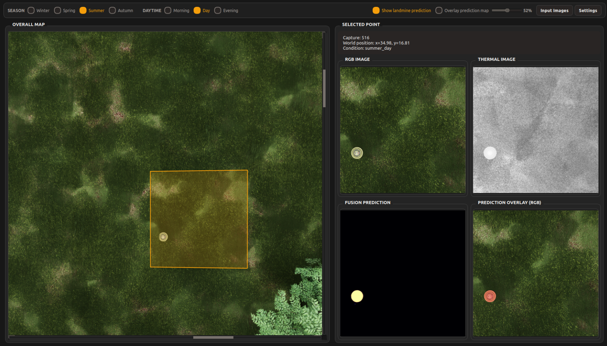

# Landmine Detection

<!-- Replace this placeholder with a screenshot captured from map/map_interface.py. -->


This repository contains the simulation, dataset-generation, computer-vision,
and temporal RGB/thermal segmentation pipelines used for landmine detection.
The main deep-learning work is organized under `fusion_training/`. The models
operate on images and ordered condition histories, and produce binary
landmine-segmentation masks.

The repository combines:

- RGB spatial encoding;
- temporal aggregation with ConvLSTM or U-TAE-style attention;
- thermal-image encoding and temporal modeling;
- asynchronous RGB/thermal fusion;
- synthetic data generation in Isaac Sim;
- full-map mosaicing and interactive map inspection; and
- YOLO-format dataset preparation and training utilities.

## Repository layout

```text
landmine-detection/
├── fusion_training/       # RGB, thermal, temporal, and fusion models
├── isaacsim/               # Isaac Sim extensions and Pegasus simulator code
├── map/                    # Full-map mosaics and interactive map viewer
└── yolo_training/          # Dataset preparation, YOLO training, and evaluation
```

The training packages share feature and data contracts. In particular, the
spatial encoders expose three feature scales (`1/2`, `1/4`, and `1/8`) with
channel widths of 32, 64, and 128. Temporal modules consume histories of
those features and return one feature pyramid for the segmentation decoder.

## Processing pipeline

The phases form a reusable progression rather than a single mandatory command
line pipeline:

1. **Phase 1A** learns the RGB spatial representation and decoder.
2. **Phase 1B** adds temporal reasoning to RGB observations.
3. **Phase 1C** provides the thermal-image spatial encoder and its U-TAE
   temporal counterpart.
4. **Phase 1D** provides the thermal ConvLSTM temporal model and shared
   condition/sequence data handling.
5. **Phase 2** combines RGB and thermal branches and supports both the
   ConvLSTM and U-TAE temporal families.

The temporal histories normally represent the fixed set of seasonal and
daytime conditions:

```text
winter_morning, winter_day, winter_evening,
spring_morning, spring_day, spring_evening,
summer_morning, summer_day, summer_evening,
autumn_morning, autumn_day, autumn_evening
```

Availability masks allow individual conditions or modalities to be missing.
This is important for evaluating RGB-only, thermal-only, and asynchronous
RGB/thermal scenarios.

## Fusion training packages

### Phase 1A: RGB spatial encoder

Path: `fusion_training/phase1a_rgb_encoder/`

Phase 1A is the shared RGB spatial foundation. It contains:

- `models.py` — a ResNet-18-derived RGB encoder and multiscale decoder;
- `data.py` — RGB dataset loading and validity handling;
- `training.py` — training orchestration;
- `inference.py` — inference helpers;
- `losses.py` and `metrics.py` — segmentation losses and evaluation metrics;
- `scripts/` — manifest generation, validation, training, visualization, and
  dataset statistics; and
- `tests/` — model-contract tests.

The encoder accepts RGB plus an optional validity channel. Its first
convolution is adapted from ResNet-18 to four channels; pretrained RGB
weights can be retained while the validity-channel weights are initialized
separately. It emits feature maps at `1/2`, `1/4`, and `1/8` resolution. The
decoder progressively upsamples these maps with skip connections and returns
a one-channel segmentation logit map.

Phase 1A is reused by both RGB temporal branches and by RGB/thermal fusion.

### Phase 1B: RGB temporal modeling

There are two implementations of Phase 1B. They use the same Phase 1A
spatial feature contract but differ in how time is aggregated.

#### Phase 1B ConvLSTM

Path: `fusion_training/phase1b_rgb_convlstm/`

Important components:

- `convlstm.py` — convolutional recurrent cell;
- `rgb_temporal_encoder.py` — one independent ConvLSTM per spatial scale;
- `models.py` — Phase 1A encoder, temporal module, and decoder integration;
- `data/` — point-sequence loading and optional feature caching;
- `scripts/` — manifest construction, feature-cache generation, training,
  validation, testing, inference, and temporal export; and
- `tests/` — ConvLSTM and temporal-encoder tests.

The ConvLSTM branch processes each feature scale recurrently. At every scale,
the convolutional gates preserve spatial structure while the hidden state
accumulates information across the ordered condition sequence. The final
hidden representation at each scale is decoded into the segmentation mask.
The package also contains a temporal-mean baseline and a cached-feature mode,
which can avoid recomputing the Phase 1A encoder.

#### Phase 1B U-TAE

Path: `fusion_training/phase1b_rgb_utae/`

Important components:

- `models.py` — masked multiscale temporal attention and RGB U-TAE model;
- `time_encoding.py` — condition/time feature encoding;
- `config.yaml` — training configuration;
- `scripts/` — manifest construction, training, validation, testing,
  inference, encoder export, and attention visualization; and
- `tests/` — U-TAE and time-encoding tests.

The U-TAE branch replaces recurrent hidden states with learned-query temporal
attention. Feature histories are adapted to common channel spaces, temporal
features are injected, and attention scores are computed independently at
multiple heads. Explicit validity masks prevent padded or unavailable frames
from contributing. The resulting multiscale aggregates are passed to the
same style of segmentation decoder.

Compared with ConvLSTM, U-TAE is more directly order-aware through time
features and can select different observations per spatial location. It also
supports attention diagnostics, including attention weights and observation
counts.

### Phase 1C: thermal-image spatial encoding and U-TAE temporal branch

The repository contains two related thermal packages:

#### Thermal-image spatial encoder

Path: `fusion_training/phase1c_thermal_image_encoder/`

This package provides the thermal-image equivalent of the Phase 1A spatial
model:

- `models.py` — ResNet-18-derived thermal image encoder and decoder;
- `data.py` — thermal image dataset handling;
- `scripts/` — dataset preparation, training, validation, visualization, and
  encoder export; and
- `tests/` — image-model tests.

The encoder converts three-channel rendered thermal images into the same
three-scale feature interface used by the RGB branch. Keeping the feature
interface compatible allows the thermal branch to reuse temporal aggregators
and fusion modules.

#### Thermal-image U-TAE

Path: `fusion_training/phase1c_thermal_image_utae/`

This package is the U-TAE temporal thermal variant. It combines the thermal
image encoder and decoder from Phase 1C with the shared
`UTAETemporalAggregator` used by the RGB U-TAE implementation. Its scripts
cover manifest construction, training, validation, testing, inference,
attention visualization, and encoder export.

The thermal U-TAE model accepts `[batch, time, channels, height, width]`
histories, propagates frame and feature validity masks, aggregates the three
feature scales, and decodes the aggregates into a segmentation map.

### Phase 1D: thermal temporal branches

The thermal temporal implementations are split across the following actual
directories. Together they represent the ConvLSTM and U-TAE versions of the
thermal temporal stage.

#### Phase 1D ConvLSTM

Path: `fusion_training/phase1d_thermal_image_convlstm/`

This package combines the thermal spatial encoder with the shared RGB
ConvLSTM implementation:

- `temporal_models.py` — thermal encoder, temporal aggregator, and decoder;
- `temporal_data.py` — thermal sequence dataset handling;
- `sequence.py` — condition ordering and sequence utilities;
- `scripts/` — temporal manifest generation, training, validation, testing,
  inference, and encoder export; and
- `tests/` — temporal image tests.

The model encodes every thermal frame spatially, reshapes the features into a
time sequence, applies one ConvLSTM per feature scale, and decodes the final
temporal features. `condition_present` masks support incomplete histories.

#### Phase 1D U-TAE counterpart

The U-TAE counterpart is implemented in
`phase1c_thermal_image_utae/`, described above. It is named under Phase 1C in
the current repository because it extends the thermal image encoder directly,
while the ConvLSTM implementation is kept under the explicit
`phase1d_thermal_image_convlstm/` directory. Both packages serve the same
thermal-temporal role and use the same multiscale decoder contract.

## Phase 2: RGB/thermal fusion

Phase 2 consumes RGB and thermal histories and supports independent modality
availability. Each branch has its own spatial encoder and temporal model;
their multiscale outputs are fused before segmentation decoding.

### Phase 2 ConvLSTM fusion

Path: `fusion_training/phase2_rgb_thermal_image_fusion/`

Main components:

- `models.py` — RGB/thermal branches, mask-aware multiscale fusion, and
  segmentation decoder;
- `data.py` — paired RGB/thermal sequence loading and normalization;
- `scripts/build_image_fusion_manifest.py` — sequence-manifest construction;
- `scripts/qa_image_fusion_manifest.py` — manifest and image validation;
- `scripts/train_image_fusion.py` — training;
- `scripts/validate_image_fusion.py` — validation;
- `scripts/test_image_fusion.py` — scenario evaluation;
- `scripts/infer_image_fusion.py` — single-sequence inference; and
- `tests/` — package tests.

The default temporal branches are the Phase 1B and Phase 1D ConvLSTM
aggregators. At each scale, `MaskAwareFusion` concatenates RGB features,
thermal features, and both validity masks. A learned convolutional block then
produces the fused representation. If a modality is absent, zero features and
validity masks preserve the same interface for RGB-only or thermal-only
evaluation.

The package supports variable RGB and thermal histories, condition masks, and
scenario sweeps such as RGB-only, thermal-only, and mixed modality counts.

### Phase 2 U-TAE fusion

Path: `fusion_training/phase2_rgb_thermal_image_utae/`

Main components:

- `models.py` — asynchronous RGB/thermal U-TAE segmenter;
- `data.py` — U-TAE-compatible multimodal data handling;
- `manifest.py` — observation metadata, timestamps, modality ages, and
  legacy-manifest conversion;
- `config.yaml` — training configuration; and
- `__init__.py` — package definition.

The U-TAE fusion model aggregates RGB and thermal histories independently.
Each modality returns multiscale features, availability maps, observation
counts, and attention details. `MaskedModalityFusion` then computes
availability-aware modality weights using feature values, observation counts,
and modality ages. This supports asynchronous observations: RGB and thermal
frames do not need to be present at the same time or in equal numbers.

The model can freeze pretrained modality encoders and temporal aggregators,
which is useful when Phase 1 branches are trained before Phase 2 fusion.
Attention and modality-fusion weights can be returned for diagnostics and
visualization.

## ConvLSTM and U-TAE comparison

| Property | ConvLSTM family | U-TAE family |
|---|---|---|
| Temporal mechanism | Recurrent convolutional hidden state | Learned-query masked temporal attention |
| RGB branch | `phase1b_rgb_convlstm` | `phase1b_rgb_utae` |
| Thermal branch | `phase1d_thermal_image_convlstm` | `phase1c_thermal_image_utae` |
| Phase 2 branch | `phase2_rgb_thermal_image_fusion` | `phase2_rgb_thermal_image_utae` |
| Missing frames | `condition_present` masks | Frame/feature validity masks |
| Time representation | Optional condition-present input | Explicit condition/time features and ages |
| Diagnostics | Hidden states and temporal outputs | Attention, counts, availability, and modality weights |
| Typical strength | Sequential state accumulation and simpler temporal behavior | Flexible observation selection and asynchronous fusion |

Both families use the same overall pattern:

```text
image sequence
    │
    ├── spatial encoder ──> 1/2, 1/4, 1/8 feature histories
    │
    ├── temporal aggregator ──> one multiscale representation
    │
    └── segmentation decoder ──> landmine probability/logit map
```

## Data and manifests

The training code uses JSON manifests to describe sequences, conditions,
modality paths, target masks, splits, and metadata. A typical fusion sequence
contains one record per condition and may include:

- RGB image path;
- thermal image path;
- target/original mask path;
- metadata path;
- mine and point identifiers;
- season and daytime; and
- RGB and thermal availability flags.

Image inputs are resized to the configured tile size. RGB and rendered thermal
images use ImageNet-style normalization in the fusion data loaders. Targets
are converted to binary masks. Horizontal augmentation is applied consistently
to both modalities and the target when enabled.

Manifest QA scripts check sequence IDs, condition ordering, duplicate
conditions, paths, image readability, image modes, and target availability.

## `map/`: full-map generation and inspection

Path: `map/`

The map package turns tile-level predictions and images into world-coordinate
map views.

### `merge_full_map.py`

`merge_full_map.py` reads a full-map dataset and its `map_manifest.json`.
It selects a season/daytime condition, projects each tile using its world
corners or position, and merges the tiles into a world-coordinate mosaic.
It supports:

- configurable output resolution;
- feathered overlap blending;
- overwrite or blend overlap modes; and
- dry-run input/output validation.

The resulting mosaic and metadata are written to the configured map output
directory. The orientation convention is documented in the generated
metadata: world X increases down image rows and world Y increases to the
right.

### `map_interface.py`

`map_interface.py` is a PyQt5 interactive viewer. It can:

- display merged map images;
- load the full-map manifest and world bounds;
- navigate by world coordinates;
- overlay model predictions;
- inspect RGB and thermal inputs; and
- load the asynchronous Phase 2 U-TAE model for map-level inference.

`map_interface_config.json` stores configurable dataset, map, model, and
display paths. The interface uses the same condition ordering and temporal
metadata conventions as the fusion-training packages.

## `isaacsim/`: simulation and data generation

Path: `isaacsim/`

The Isaac Sim code supplies the synthetic environments, cameras, thermal
rendering, drone behavior, trajectories, and dataset recording used by the
training pipeline. It contains two principal extensions:

```text
isaacsim/
├── my_company.my_python_extension/
└── pegasus.simulator/
```

### `my_company.my_python_extension`

This custom Isaac Sim extension integrates the project-specific simulation
logic. Its helpers include:

- `camera_wrapper.py` — RGB camera setup and image access;
- `thermal_camera.py` — thermal rendering and thermal-image transport;
- `dataset_recorder.py` — RGB, labels, exact labels, masks, metadata, and
  dataset-session recording;
- `auto_record_manager.py` — automated capture control;
- `scene_utils.py` — scene and prim utilities;
- `velocity_reader.py` — vehicle/drone velocity access;
- `trajectory_drawer.py` and `drone_trail.py` — trajectory visualization;
- `chase_camera.py` — camera following behavior;
- `udp_helper.py` — communication with external controllers and tools; and
- `config/` — temperature maps, camera trajectories, and extension settings.

The dataset recorder maintains deterministic exact and merged label tables,
supports visibility filtering, and records metadata needed to associate each
image with camera pose, mine identity, world position, and environmental
conditions. Thermal mode can be enabled independently through Isaac Sim
settings.

### `pegasus.simulator`

This is the Pegasus-based simulator integration. It contains simulator
configuration, extension metadata, vehicle/environment management, maps,
sensors, and simulator helper code. Relevant areas include:

- `config/` — simulator and extension configuration;
- `pegasus/simulator/logic/sensors/` — IMU, magnetometer, and sensor logic;
- `pegasus/simulator/helpers/` — environment and simulator helpers;
- `pegasus/simulator/maps/` — map textures and mine/obstacle layouts; and
- `docs/` — Pegasus simulator documentation and changelog.

The simulator extensions provide the source data for the image datasets used
by the Phase 1 and Phase 2 training packages.

## `yolo_training/`

The YOLO utilities support object-detection-oriented dataset workflows in
parallel with the segmentation pipeline. They include dataset preparation and
merging, label editing, empty-label handling, visualization, training,
testing, scenario evaluation, metric plotting, and loss-curve plotting.

The YOLO labels and exact-label directories generated by the simulator are
also used by several manifest-building and validation tools in the temporal
segmentation pipeline.

## Typical development workflow

1. Generate RGB, thermal, masks, labels, and metadata in Isaac Sim.
2. Prepare and validate manifests with the phase-specific scripts.
3. Train or import the Phase 1A RGB spatial encoder.
4. Train either the RGB ConvLSTM or RGB U-TAE temporal branch.
5. Train the thermal spatial and temporal branch using either ConvLSTM or
   U-TAE aggregation.
6. Train and evaluate the corresponding Phase 2 fusion model.
7. Run scenario evaluation, attention/feature visualization, or map-level
   inference.
8. Merge full-map tiles and inspect predictions through `map_interface.py`.

Exact commands and paths are intentionally kept in each package's scripts and
`config.yaml` files because checkpoints, datasets, and compute devices are
environment-specific.

## Design principles

- **Shared feature contracts:** RGB and thermal branches expose compatible
  multiscale features.
- **Explicit validity:** missing frames and missing modalities are represented
  by masks rather than silently treated as valid observations.
- **Reusable decoders:** spatial and temporal variants can share segmentation
  decoders and pretrained encoders.
- **Manifest-driven experiments:** sequence identity, condition ordering,
  paths, splits, and metadata are explicit and verifiable.
- **Simulation-to-map traceability:** generated metadata preserves the link
  from simulator world coordinates to individual image tiles and final map
  mosaics.
